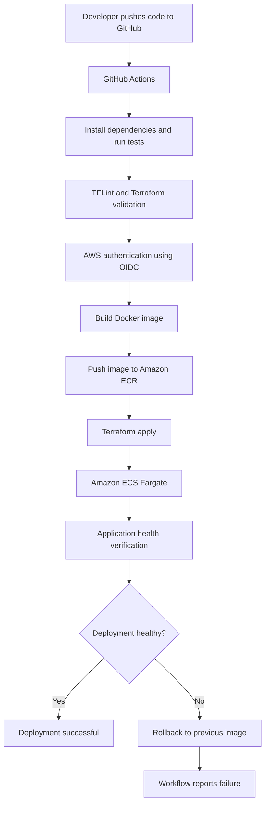

# Capstone Project 3: Zero-Touch ECS Deployments

Automated Infrastructure as Code (IaC) and CI/CD deployment using Terraform, GitHub Actions, Docker, Amazon ECR, and Amazon ECS Fargate.

## Project Objective

Automate application deployment so that a developer can push code to GitHub and have the application tested, containerized, and deployed to AWS without manually connecting to production servers.

## Architecture Diagram



## Technology Stack

- **Git and GitHub:** Source control and collaboration
- **GitHub Actions:** Automated CI/CD pipeline
- **Node.js and Express:** Application runtime and web framework
- **Docker:** Application containerization
- **Amazon ECR:** Container image registry
- **Amazon ECS Fargate:** Managed container deployment
- **Terraform:** Infrastructure as Code
- **AWS IAM OIDC:** GitHub Actions authentication to AWS
- **Application Load Balancer:** Routes requests to the application
- **TFLint:** Terraform configuration linting
- **Amazon CloudWatch:** AWS monitoring and logging

## Deployment Workflow

1. A developer pushes code to the `main` branch or manually triggers the GitHub Actions workflow.
2. GitHub Actions checks out the repository and configures Node.js.
3. Application dependencies are installed and automated tests are executed.
4. TFLint checks the Terraform configuration.
5. GitHub Actions authenticates to AWS using OpenID Connect (OIDC), avoiding long-lived AWS access keys in GitHub secrets.
6. Docker builds the application image and pushes it to Amazon ECR using the Git commit SHA as the image tag.
7. Terraform validates and applies the infrastructure and application configuration.
8. ECS deploys the application and waits for service stability.
9. The workflow verifies that ECS is running the image for the current commit.
10. The Application Load Balancer health endpoint is checked.
11. If deployment verification fails, the workflow attempts to restore the previous image through Terraform and reports the deployment as failed.

## Infrastructure and Deployment Safety

- ECS deployment circuit breaker is enabled with automatic rollback.
- Terraform manages the desired application image and infrastructure state.
- The deployment workflow checks ECS service stability and the running image version.
- The application health endpoint is checked before the workflow reports success.
- Failed deployment verification triggers an attempt to restore the previous image.
- A successful rollback does not turn a failed deployment run into a successful run.

## Application Endpoints

| Endpoint | Purpose |
|---|---|
| `/` | Application home or information endpoint |
| `/health` | Application health verification endpoint |

The health endpoint is expected to return HTTP 200 and the JSON response:

```json
{"status":"healthy"}
```

## Useful Verification Commands

Check ECS service status:

```bash
aws ecs describe-services \
  --cluster capstone3-cluster \
  --services capstone3-service \
  --region ap-south-1 \
  --query 'services[0].{Status:status,Desired:desiredCount,Running:runningCount,TaskDefinition:taskDefinition}' \
  --output table
```

Check the Terraform configuration:

```bash
terraform -chdir=terraform fmt -check -recursive
terraform -chdir=terraform validate
```

Check the application tests:

```bash
npm test
```

Check the deployment health endpoint using the ALB DNS name:

```bash
curl -i http://YOUR_ALB_DNS_NAME/health
```

Replace `YOUR_ALB_DNS_NAME` with the actual DNS name of the Application Load Balancer.

## Verification Evidence

Capture the actual results from your environment before submitting the project:

- GitHub Actions workflow run showing the test and deployment results.
- ECS service showing the desired and running task counts.
- Amazon ECR showing the versioned application image.
- Application Load Balancer health endpoint returning HTTP 200.
- Terraform validation and TFLint results.
- Rollback configuration and relevant workflow logs.

## Security

- Use GitHub OIDC for AWS authentication.
- Apply least-privilege IAM permissions in production.
- Never commit AWS credentials, private keys, or other secrets.
- Keep Terraform state in a protected remote backend with state locking.
- Review changes before deploying to the production branch.

## Project Outcome

This project demonstrates an automated container deployment workflow using CI/CD, Infrastructure as Code, AWS managed container services, application health verification, and deployment recovery procedures.
