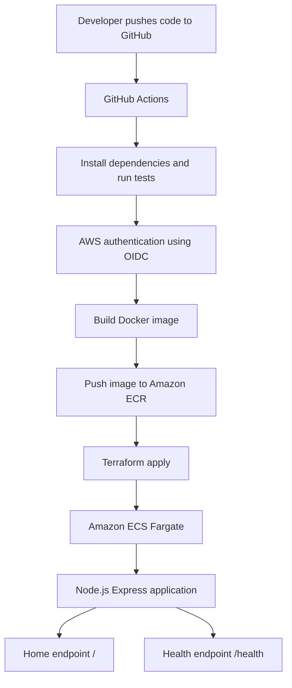

# Capstone Project 3: Zero-Touch ECS Deployments

Automated Infrastructure as Code and CI/CD deployment using Terraform,
GitHub Actions, Amazon ECR, and Amazon ECS Fargate.

## Architecture Diagram

## Technology Stack

- Git and GitHub
- GitHub Actions for CI/CD
- Node.js and Express
- Docker
- Amazon ECR
- Amazon ECS Fargate
- Terraform
- AWS IAM OIDC
- Amazon CloudWatch

## Deployment Workflow

1. Push code to GitHub or trigger the workflow manually.
2. Install dependencies and run application tests.
3. Authenticate to AWS using GitHub OIDC.
4. Build and push the Docker image to Amazon ECR.
5. Validate and apply Terraform configuration.
6. Deploy the application to ECS Fargate.
7. Wait for ECS service stability and verify deployment.

## Application Endpoints

- `/` - Application information
- `/health` - Application health status

## Verification Results

- GitHub Actions workflow completed successfully.
- ECS service reached a steady state.
- Home endpoint returned HTTP 200 OK.
- Health endpoint returned HTTP 200 OK.

## Security

- Use least-privilege IAM permissions for production.
- Never commit AWS credentials or private keys to GitHub.
